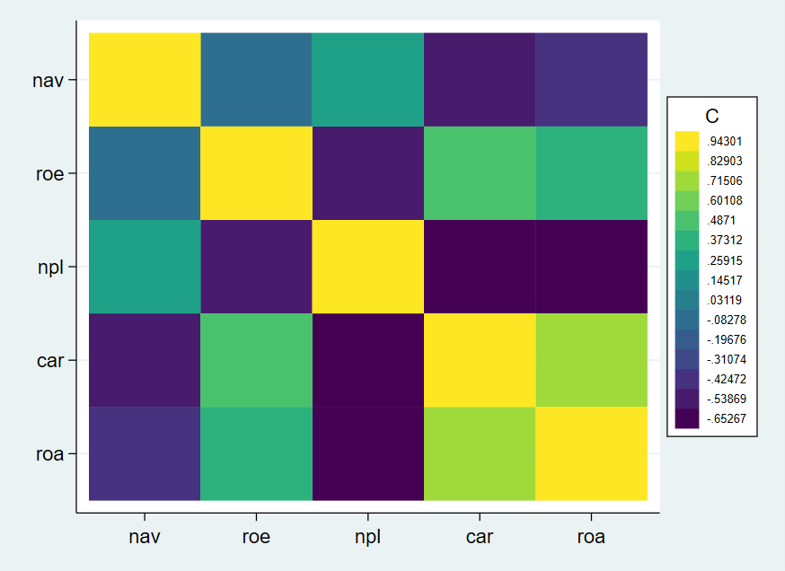
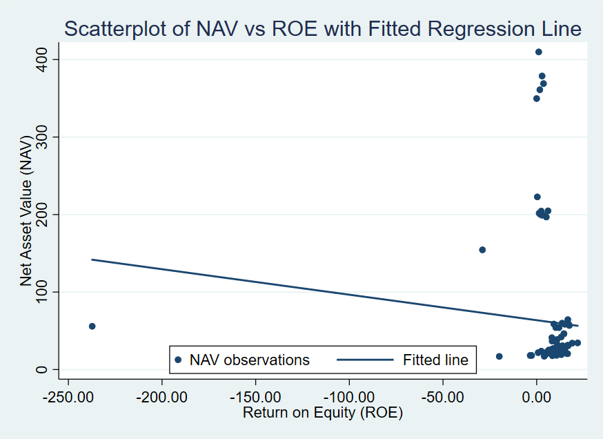
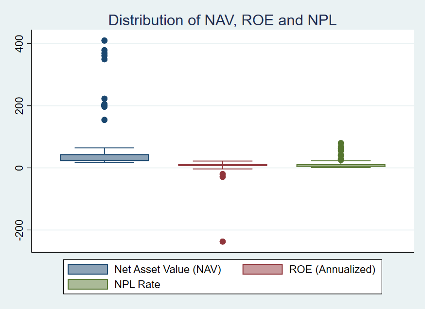
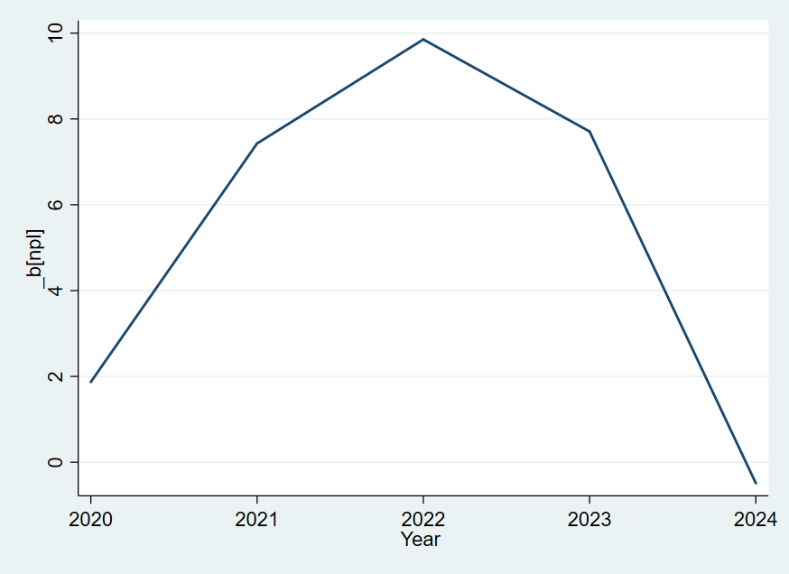

# Profitability, Credit Risk & Bank Valuation in Bangladesh

Research and analysis project examining how profitability and credit risk — and the interaction between them — shape the valuation of Bangladeshi commercial banks, using panel data regression in Stata.

## Research question
How do profitability and credit risk, and the interaction between them, affect the valuation of Bangladeshi commercial banks?

## Data
- Balanced panel of **20 listed private commercial banks, 2020–2024** (100 bank-year observations).
- Sources: annual reports, Bangladesh Bank publications, Dhaka Stock Exchange disclosures.
- Outliers winsorised at the 1st/99th percentiles.

## Method
- Narrowed 13 candidate financial indicators to a parsimonious model after correlation and multicollinearity (VIF) testing:
  **ROE, NPL ratio, CAR, and an ROE × NPL interaction term**.
- Estimated OLS, interaction, fixed-effects and random-effects panel models, plus year-wise regressions in **Stata**.

## Key findings
- The panel model explained **84%** of within-bank variation in Net Asset Value (R² = 0.84).
- Profitability (ROE) **raises** bank value; credit risk (NPL) **lowers** it.
- Capital adequacy (CAR) cushions NPL-related losses.
- Strong profitability offsets the valuation impact of credit risk.

## Charts
| | |
|---|---|
|  |  |
| Correlation heatmap of key variables | NAV vs ROE with fitted regression line |
|  |  |
| Distribution of NAV, ROE and NPL | Year-wise effect of NPL on NAV, 2020–2024 |

Distribution histograms: [NAV](charts/nav_hist.png) · [ROE](charts/roe_hist.png) · [NPL](charts/npl_hist.png)

## Tools
Stata · Panel data regression · Financial ratio analysis · Hypothesis testing

## Repository contents
| File | Description |
|---|---|
| `Commands.do` | Stata do-file: data preparation, diagnostics and all regressions |
| `regression_output.txt` | Full Stata regression output |
| `stata files (NAV) modified.dta` | Final panel dataset (20 banks, 2020–2024) |
| `charts/` | Charts produced in Stata |

## Author
**Shabab Tousif Aman** — Master of Business Analytics, Adelaide University
